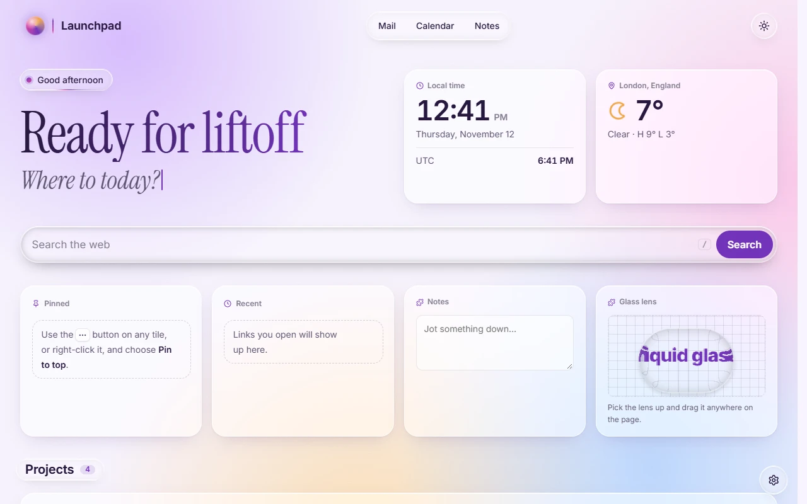
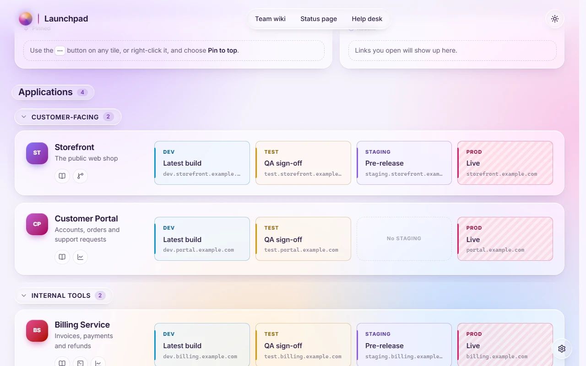
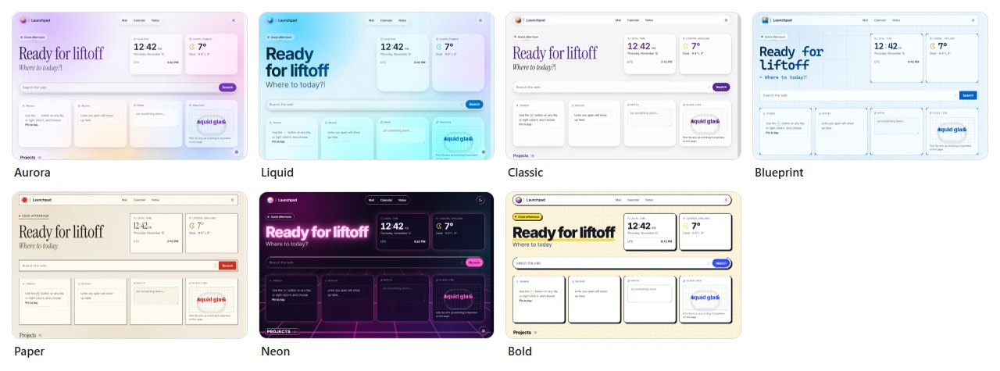
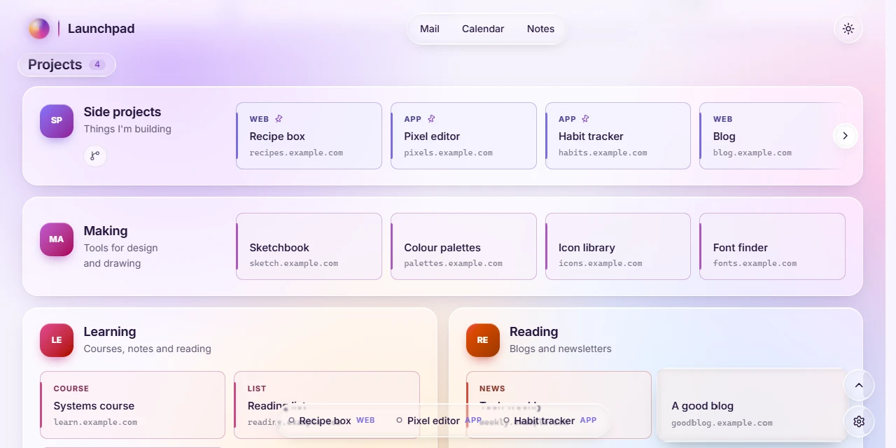

# Launchpad

**A single-page home for your links.** One `index.html` that runs straight from disk, set up by one config file beside it.

**[Try the live demo →](https://j-houghton.github.io/launchpad/)** · [Docs](docs/README.md) · [Download](https://github.com/J-Houghton/launchpad/releases/latest)

<picture>
  <source media="(prefers-color-scheme: dark)" srcset="docs/images/home-dark.webp">
  
</picture>

## Two kinds of page

- **A personal home page**: your projects, sites and bookmarks, sorted into cards by category (above).
- **A launch page**: each card is an app, with a tile for each of its environments (DEV, TEST, PROD…), lined up in columns from card to card (below).



## What you get

- **No server.** It builds to one self-contained `index.html`. The page reads `launchpad.config.js` next to it; set it up once and share that file with your team.
- **Edit it in the page.** Settings (<kbd>Ctrl</kbd>+<kbd>,</kbd>) changes everything, and saves straight back to the config file. [Editing and saving →](docs/functional/editing.md)
- **Arrange it on a 12-column grid.** Drag sections around and resize them, right on the page. [Layout →](docs/functional/layout.md)
- **Pins, recents and status dots.** Pin the tiles you use most, see what you opened recently, and optionally check that each host answers.
- **Widgets.** A clock and the weather, another site in a frame, or live data from any JSON address through a small template. [Widgets →](docs/functional/widgets.md)
- **Extensions.** Script files beside the page add widgets and backgrounds. Five examples are included: a search box, notes, a countdown, a starfield and a glass lens. [Extensions →](docs/functional/extensions.md)
- **Yours and everyone's.** Personal choices (your look, pins, hidden cards) stay in your browser and never change the page for anyone else.
- **Private.** Everything runs in your browser. [What leaves it →](docs/functional/status-and-privacy.md)

## Seven styles

Each comes in light and dark, and changes shapes, type and texture as well as colour. Pick colour combos, fine-tune any colour, or add [your own CSS](docs/functional/custom-css.md).



Aurora, Liquid and Neon draw their controls in **liquid glass**, after Apple's guidelines: the controls that float over the page are glass, and the content isn't. Chrome and Edge draw the bending lens; other browsers show frosted glass. [Styles, colours and liquid glass →](docs/functional/looks.md)



## Quick start

**Use a ready-made build.** Download `launchpad-vX.Y.Z.zip` from the [latest release](https://github.com/J-Houghton/launchpad/releases/latest), unzip it and open `index.html`. A first-run guide walks you through the rest.

Already set up? Replace your `index.html` with the one attached to the release. Your `launchpad.config.js` keeps working, including configs written for older versions.

**Or build it yourself** (Node 22 or newer):

```sh
npm install
npm run build      # → dist/index.html, plus the sample config and example extensions
```

Open `dist/index.html` in your browser.

## Docs

| | |
| --- | --- |
| **Using it** | [A tour of the demo](docs/functional/tour.md) · [Editing and saving](docs/functional/editing.md) · [The config file](docs/functional/config.md) · [Layout](docs/functional/layout.md) · [Widgets](docs/functional/widgets.md) · [Styles and glass](docs/functional/looks.md) · [Custom CSS](docs/functional/custom-css.md) · [Extensions](docs/functional/extensions.md) · [Status checks and privacy](docs/functional/status-and-privacy.md) |
| **Working on it** | [Architecture](docs/technical/architecture.md) · [Liquid glass](docs/technical/liquid-glass.md) · [Extension API](docs/technical/extension-api.md) · [Testing](docs/technical/testing.md) · [Building and releasing](docs/technical/releasing.md) |

## Development

```sh
npm run dev        # dev server with live reload
npm test           # build, then drive the page in a real browser (about 4 minutes)
```

Every push to `main` deploys the demo and publishes a release. See [Building and releasing](docs/technical/releasing.md).

## Built with

[Lit](https://lit.dev/) and [Vite](https://vite.dev/), with [liquid-glass-filter](https://github.com/J-Houghton/LiquidGLass-UI) for the glass, [Lucide](https://lucide.dev/) icons and the [Inter](https://rsms.me/inter/) and [Instrument Serif](https://fonts.google.com/specimen/Instrument+Serif) typefaces (SIL Open Font License 1.1), bundled into the build.

## License

[MIT](LICENSE)
