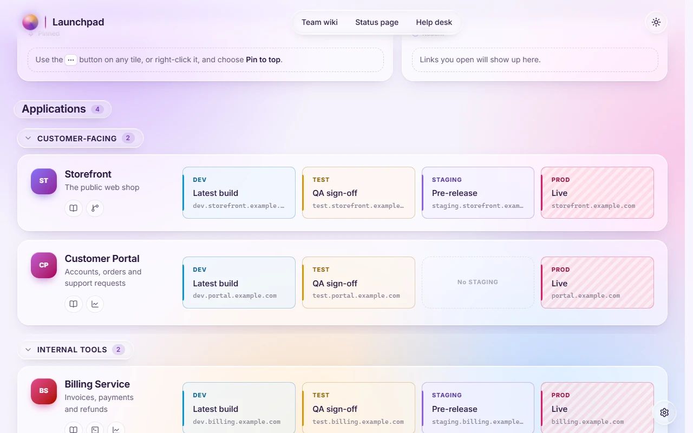

# The config file

Everything the page shows lives in `launchpad.config.js`, next to `index.html`. Change it and reload; no rebuild is needed. [Settings writes it for you](editing.md), but it's also easy to edit by hand.

The file is a plain script: JSON after `window.LAUNCHPAD_CONFIG =`. Keep it valid JSON.

> **See a real one:** the demo's config is [`public/launchpad.config.js`](../../public/launchpad.config.js). In the [demo](https://j-houghton.github.io/launchpad/), Settings → Edit page → File → **Download a copy** gives you the file for whatever you've set up there.

## Keys

| Key | What it sets |
| --- | --- |
| `site` | `title`, `heading` (shown above the cards, e.g. `"Projects"`; `""` hides it), `footer`, and an optional `logo` (a path like `"./logo.svg"`, or an SVG uploaded in Settings) |
| `statusChecks` | `true` / `false`: [reachability dots](status-and-privacy.md) for the whole page |
| `useColumns` | `true` / `false`: line tiles up in `columns` (a launch page) |
| `columns` | the columns: `id`, `label`, `color`, and `caution: true` for a "handle with care" hatch |
| `groups` | named sections of cards: `id`, `name` |
| `links` | header links: `label`, `url` |
| `cards` | `id`, `name`, `description`, `badge`, `group`, `links` (buttons under the name), `health: false` to skip its checks, `span` and `newRow` (see [Layout](layout.md)), and `tiles` (below) |
| `widgets` | `greeting`; `clock` (`zones`; `"timeZone": "local"` follows the viewer); `weather` (`place`, `latitude`, `longitude`, `units`); `added`, your own (see [Widgets](widgets.md)) |
| `layout` | `density` (`"comfortable"` or `"compact"`) and `sections` (see [Layout](layout.md)) |
| `look` | `theme` (`"system"`, `"light"`, `"dark"`), `style` (`"aurora"`, `"liquid"`, `"classic"`, `"blueprint"`, `"paper"`, `"neon"`, `"bold"`), `background` (`"particles"`, `"still"`, `"plain"`), plus `colors` (see [Styles](looks.md#colours)) and `css` (see [Custom CSS](custom-css.md)). Anyone's own choices in My view come first |
| `extensions` | extension files to load, as paths beside `index.html`, e.g. `"extensions/notes.js"` (see [Extensions](extensions.md)) |

## Tiles

On a **home page**, a tile is a name and an address:

```json
{ "name": "Recipe box", "url": "https://recipes.example.com", "label": "WEB" }
```

`label` is the small tag and is optional. So are `color` and `id`; give an `id` if you want pins to survive renaming the tile.

On a **launch page**, a tile names its column instead:

```json
"useColumns": true,
"columns": [
  { "id": "dev", "label": "DEV", "color": "#0b95da" },
  { "id": "prod", "label": "PROD", "color": "#e61a5e", "caution": true }
],
"cards": [
  {
    "id": "billing", "name": "Billing", "links": [{ "label": "Docs", "url": "https://docs.example.com/billing" }],
    "tiles": [
      { "column": "dev", "url": "https://dev.billing.example.com", "name": "Latest build" },
      { "column": "prod", "url": "https://billing.example.com", "name": "Live" }
    ]
  }
]
```



Turning `useColumns` off keeps the columns; their tiles show as ordinary tiles tagged with the column's name.

Any tile can take `"health": false`, which skips its reachability check.

## Older configs

Configs from earlier versions (with `apps`, `envs` and `environments`) still load, and are saved in the current format.

## CSV import

Settings → Edit page → Cards → **Spreadsheet** → **Import from CSV** accepts either layout. Unknown columns and groups are created for you, and **Download a template** gives you a starting point. **Export as CSV** goes the other way.

- **One row per link:** `category`, `name` and `url` columns, plus optional `tag`, `description` and `group`. Rows with the same category share a card. A `column` value puts that row's tile in one of the page's columns.
- **One row per card**, for a launch page: a `name` column, plus optional `description`, `group` and `badge`. Add one more per page column, headed by its label (e.g. `DEV`), and `link:Docs`-style columns for link buttons.

> **Try it in the [demo](https://j-houghton.github.io/launchpad/):** Settings → Edit page → Cards → Spreadsheet → Export as CSV, change a row, and import it again.

## Rebuilding

If you build from source, `npm run build` replaces `dist/launchpad.config.js` with the one from `public/`. Copy your edited config back to `public/` first, or keep your live copy outside `dist`.
