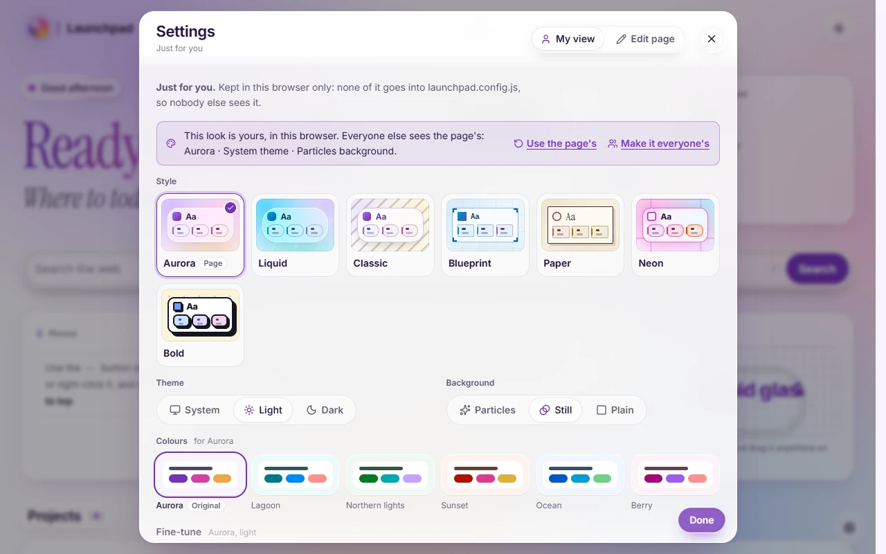
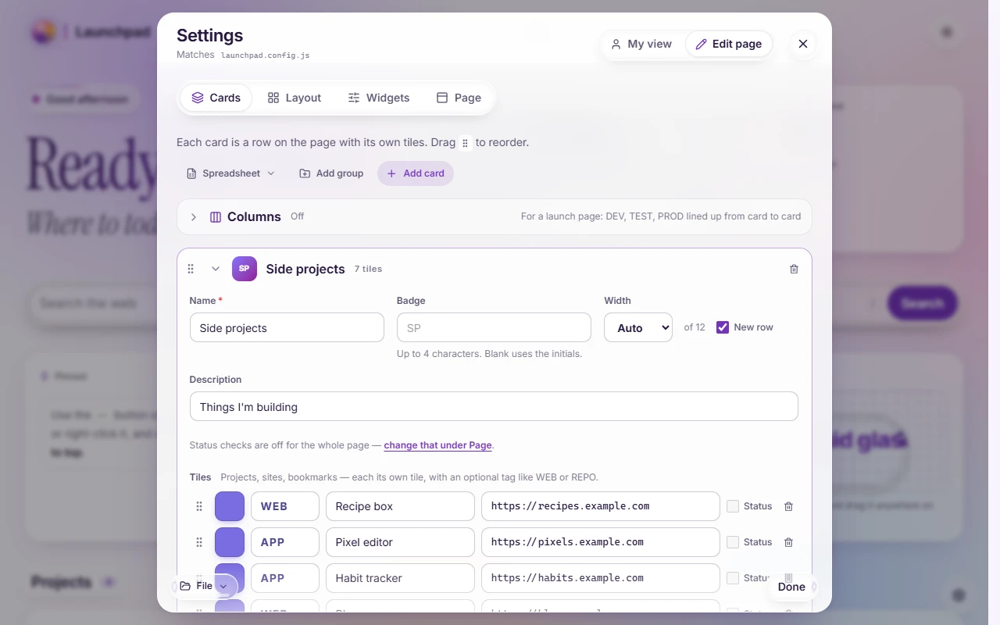

# Editing and saving

Everything about the page can be changed in the page itself. Open Settings with <kbd>Ctrl</kbd>+<kbd>,</kbd> (<kbd>⌘</kbd>+<kbd>,</kbd> on a Mac), or the gear at the bottom of the page.

## Yours, or everyone's?

Settings has two halves, and the difference between them is who sees the change.

| | Who sees it | Where it's kept |
| --- | --- | --- |
| **My view** | Only you | This browser. Never written to the config file |
| **Edit page** → **Save** | Only you, for now | This browser, until you save to the file |
| **Edit page** → **Save to file** | Everyone who opens the page | `launchpad.config.js`, next to `index.html` |

**Make it everyone's**, in My view, copies your look into Edit page, ready to save to the file.

### My view

- **Style**, **Theme** and **Background**: see [Styles, colours and liquid glass](looks.md).
- **Colours**: a combo for the style you're using, then fine-tuning.
- **Cards on my page**: hide the cards you don't use. The search box filters the list.
- **Motion**: System, Full or Reduced.
- **Pins and history**: clear them.

Changes apply as you make them.

### Edit page

Four tabs:

- **Cards**: add, rename and reorder cards and their tiles (drag the handles). On a launch page, the columns are here too. **Spreadsheet** imports and exports cards as CSV; see [The config file](config.md#csv-import).
- **Layout**: widths and rows for each section, density, and **Arrange on the page**. See [Layout](layout.md).
- **Widgets**: the greeting, clock and weather, plus widgets you add. See [Widgets](widgets.md).
- **Page**: title, logo, header links, status checks, [custom CSS](custom-css.md) and [extensions](extensions.md).

Edits are a draft until you save. With nothing to save, the footer shows **Done**; make a change and **Save** and **Save to file** appear beside **Cancel**.

> **Try it in the [demo](https://j-houghton.github.io/launchpad/):** Settings → Edit page → Cards, open "Side projects" and rename it. Watch the footer's buttons part. **Save** keeps it in your browser only.

## Saving to the file

How **Save to file** works depends on where the page is running:

- **Chrome and Edge**: you pick `launchpad.config.js` once, and later saves go straight to it.
- **Other browsers**: the page downloads a new `launchpad.config.js` for you to put next to `index.html`.
- **`npm run dev`**: the dev server writes `public/launchpad.config.js` itself.

The **File** menu, at the bottom of Edit page, covers the rest:

- **Open a file…** loads a `launchpad.config.js` or a `.json` copy.
- **Download a copy** gives you the current settings as a file.
- **Use the file's version** forgets changes saved only in this browser.
- **Start from an example** loads a home page or a launch page to look around.

## Sharing a config

`launchpad.config.js` is the whole page. Send it to someone, or commit it, and they get your cards, layout and look. Their own My view choices still come first on their machine.

When you open someone else's config in Settings, the page asks before keeping three things from it, because each can reach beyond the page: [custom CSS](custom-css.md), [extensions](extensions.md), and widgets that show other sites.

Configs written for older versions still load, and are saved in the current format.

## The first-run guide

A page with no config walks you through it: name the page, choose "just links" or a set of columns, then add a few cards or paste them from a spreadsheet. Or skip the guide and start from an example. Everything it sets can be changed later in Settings.

## If something goes wrong

Add `?safe` to the end of the page's address (`index.html?safe`). Custom CSS, custom colours and extensions stay off until you take it away again, so you can always get back to Settings.
