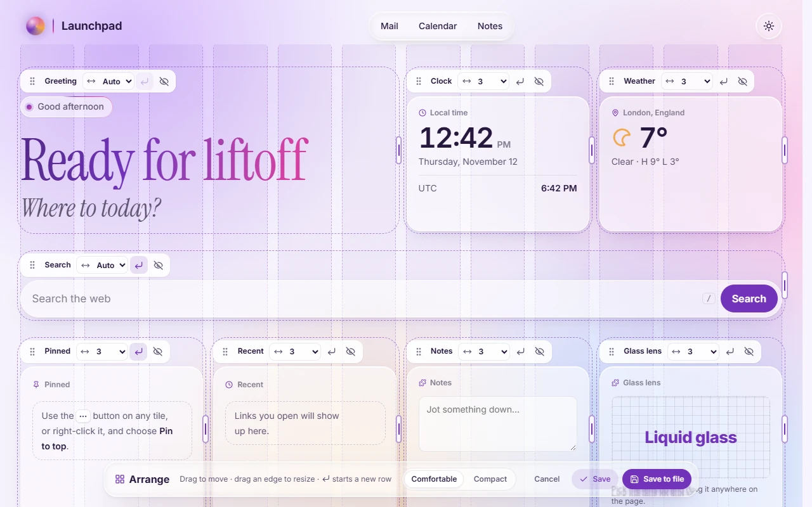

# Layout

The page is a 12-column grid, as in Oracle APEX or Bootstrap. Every **section** (greeting, clock, weather, pinned, recent, the cards, and each widget you add) and every **card** has a place on it.

## The rules

- **Width.** `"span": 1`–`12` sets an item's width in columns. Leave it out (**Auto**) and the item shares what's left of its row equally with the other Auto items.
- **Rows.** Each item starts a new row unless it has `"newRow": false`, which puts it beside the item before when there's room.
- **Smaller screens.** On medium screens, anything a third wide or less goes half width and the rest full width. On phones, only quarter-width items, like the clock and weather, stay side by side.

## Arranging on the page

Settings → Edit page → Layout → **Arrange on the page** shows the grid faintly behind the page and gives every section and card a small toolbar.



- **Drag** the grip to move something. With the keyboard, focus the grip and use the arrow keys.
- **Drag the right edge** to resize, or pick a width from the list.
- **↵** starts a new row; the eye hides the section.
- The bar at the bottom sets the density, brings hidden sections back, and saves or cancels. <kbd>Esc</kbd> cancels too.

The Layout tab in Settings has the same controls as a list.

> **Try it in the [demo](https://j-houghton.github.io/launchpad/):** arrange the page, drag the weather's right edge to make it wider, move Notes somewhere else, and press **Save**. It's kept in your browser only.

## In the config

The sample page puts the greeting beside the clock and weather, a search box under them, then four small panels in a row:

```json
"layout": {
  "density": "comfortable",
  "sections": [
    { "id": "greeting" },
    { "id": "clock", "span": 3, "newRow": false },
    { "id": "weather", "span": 3, "newRow": false },
    { "id": "search" },
    { "id": "pinned", "span": 3 },
    { "id": "recent", "span": 3, "newRow": false },
    { "id": "notes", "span": 3, "newRow": false },
    { "id": "lens", "span": 3, "newRow": false },
    { "id": "cards" }
  ]
}
```

- Each section appears once, in page order. An added widget's section is its `id`.
- Add `"hidden": true` to hide a section. Every section except the cards can be hidden.
- Cards take `span` and `newRow` too. To put two cards side by side, give the second one `"newRow": false`.
- `"density": "compact"` fits more on screen.

## Groups

Cards can be sorted under **groups**: headed sections that fold away when you click the heading. Define them in `groups` (`id`, `name`) and give each card a `group`. Cards without one gather under "Other".

In the glass styles, a group's heading stays under the header while its cards scroll by.

> **Try it in the [demo](https://j-houghton.github.io/launchpad/):** Settings → Edit page → File → **Launch page** loads an example with two groups, "Customer apps" and "Internal tools". Click a heading to fold it.
