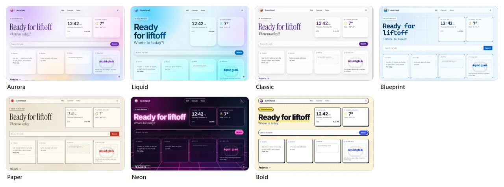
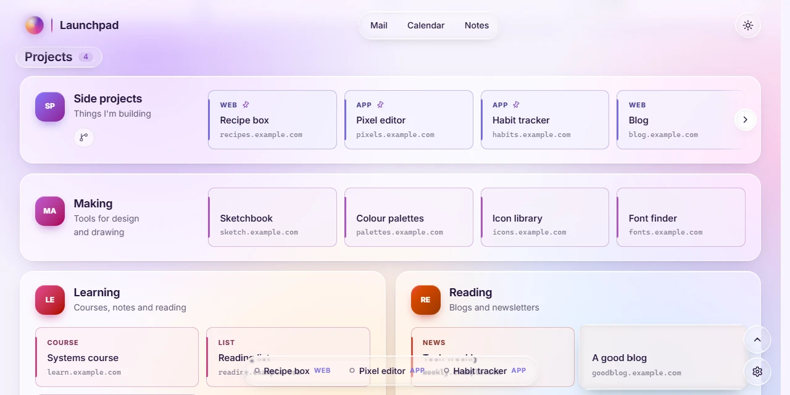
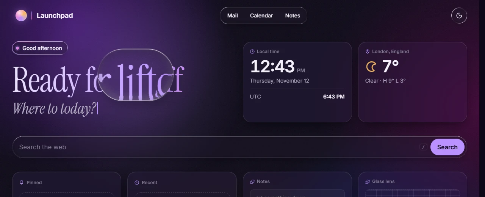

# Styles, colours and liquid glass

Pick a look in Settings → **My view**. It's yours alone until you choose **Make it everyone's**, which copies it into the page's config.

## Styles

Seven styles, each light or dark. A style changes shapes, type and texture as well as colour.



| Style | What it's like |
| --- | --- |
| **Aurora** | a soft glow behind frosted panels. The default |
| **Liquid** | clear, rounded panels over a vivid glow and fine lines |
| **Classic** | crisp panels with striped margins |
| **Blueprint** | grid paper, square corners and monospaced type |
| **Paper** | a printed look, with serif headings and inked outlines |
| **Neon** | a glowing grid at night |
| **Bold** | chunky borders and hard shadows |

**Theme** is System, Light or Dark. **Background** is drifting particles, the style's backdrop alone (Still), or a plain colour. Extensions can add more backgrounds.

> **Try it in the [demo](https://j-houghton.github.io/launchpad/):** Settings → My view, and click through the styles. In a row of choices like Theme, you can also drag the selection along the row.

## Colours

Under **Colours**, each style starts with a few ready-made **combos**, such as Aurora's Lagoon, Sunset and Ocean, or Paper's blue and green inks. A combo keeps the style's own look and works in light and dark. The glow, borders, particles and cards' colours all follow it.

Below the combos, **Fine-tune** changes any of the style's six colours in a picker: background, panels, text, accent, second accent and highlight. Fine-tuning is kept separately for light and dark, and each style keeps its own colours.

**Make it everyone's** writes them into the page's look:

```json
"look": {
  "theme": "system", "style": "aurora", "background": "particles",
  "colors": {
    "aurora": { "hues": [200, 250, 25], "light": { "accent": "#0a9396" }, "dark": { "bg": "#0b1d26" } }
  }
}
```

- `hues` is the combo: the hues of the accent, second accent and highlight, from 0 to 360. Classic's are HSL hues; the other styles use OKLCH hues.
- `light` and `dark` hold single colours as `#rrggbb`. The keys are `bg`, `panel`, `ink` (text), `accent`, `accent-2` and `accent-3`.
- Anything you leave out is the style's own.

If the colours ever make the page hard to read, add `?safe` to the end of its address to leave them off.

## Liquid glass

Aurora, Liquid and Neon follow Apple's Liquid Glass guidelines: glass is kept for the **controls that float over the page**. The cards and widgets are the content, and stay on the style's frosted panels.



What's glass:

- **The header.** The links share one capsule, beside a round theme button. What scrolls under the header blurs and fades so they stay easy to read.
- **Controls on the page.** The greeting's pill, the search box (its Search button is the one tinted with the accent), the gallery arrows, tile menus, toasts and the arranging toolbar. Menus grow out of the button that opens them.
- **A dock.** Once the Pinned panel has scrolled out of sight, or if it's left off the page, your pins come up in a bar at the bottom of the window.
- **Corner buttons.** Settings, joined by "back to the top" once you've scrolled.
- **Sticky headings.** A group's heading, or the cards' own, stays under the header while its cards scroll by.
- **A tile lens.** One lens glides to the tile under the pointer, or the one the keyboard is on, and draws it a touch larger.

How it behaves: glass bends whatever is behind it, and its edge catches a fine line of light, from above the page and from the pointer as it comes near. Buttons swell and squish when pressed.

**Settings** works the same way. The sheet stays plain and its controls float over it. In a row of choices, the selection lifts into a lens you can drag. Switches, and the colour picker's hue, have knobs that turn into clear lenses while you hold them. With nothing to save, the footer's buttons merge into **Done**.



The **Glass lens** widget is a lens to play with: pick it up and drag it over the page. It's an [extension](extensions.md), and it's glass in every style.

> **Try it in the [demo](https://j-houghton.github.io/launchpad/):** drag the Glass lens over the greeting. Pin a few tiles and scroll down to bring up the dock. Hold a switch in Settings → My view and slide it.

### Browsers

The bending lens is drawn by **Chrome and Edge**. Other browsers show the same controls as frosted glass.

### Accessibility

- If your device asks for **less transparency**, the glass turns frostier.
- If it asks for **more contrast**, the glass gets a solid edge.
- **Less motion** (your device's setting, or Motion → Reduced in My view) turns off the squish and the lifting, and the light turns at once instead of gliding. It also stops the moving background, the greeting's typing and the page's sliding transitions.
