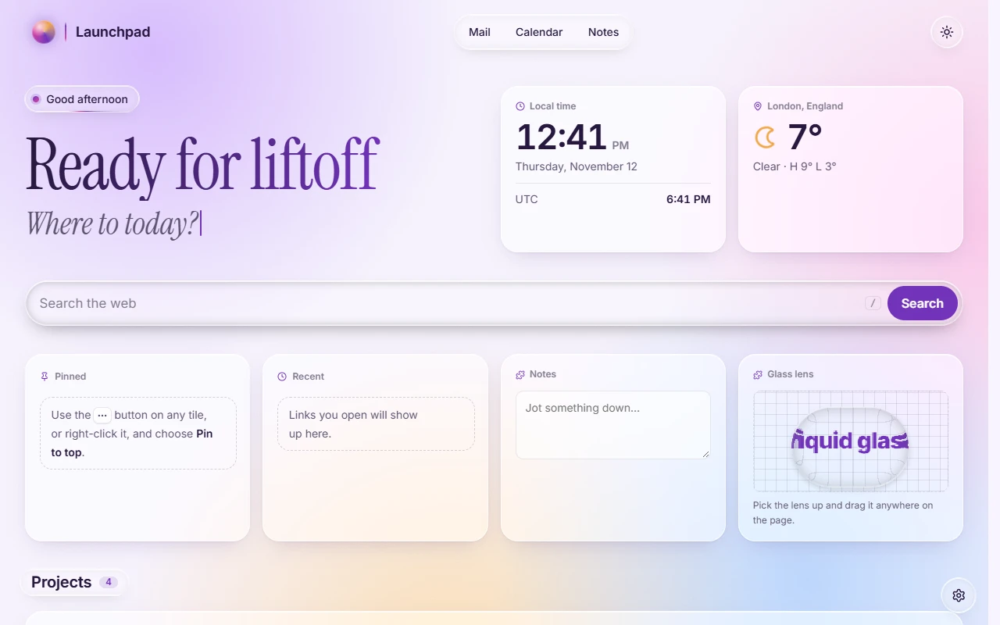
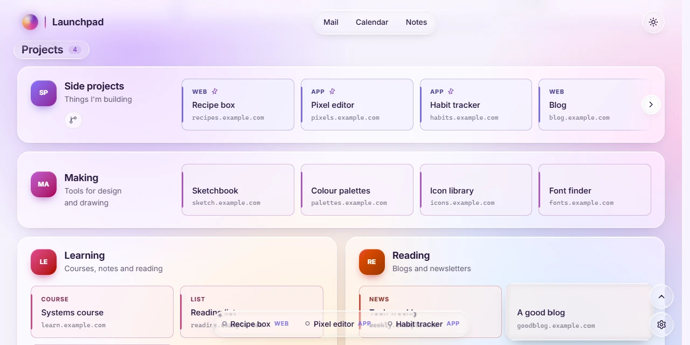
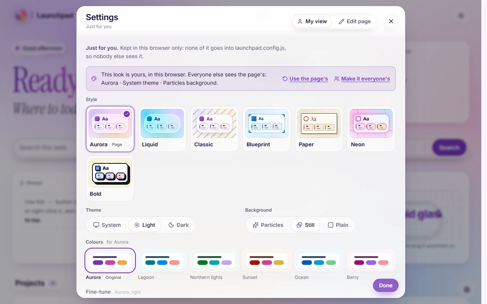
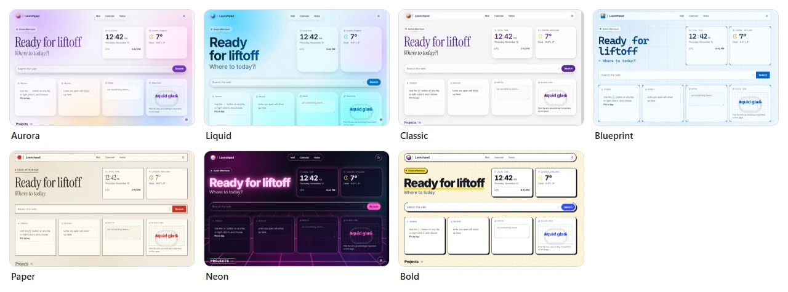
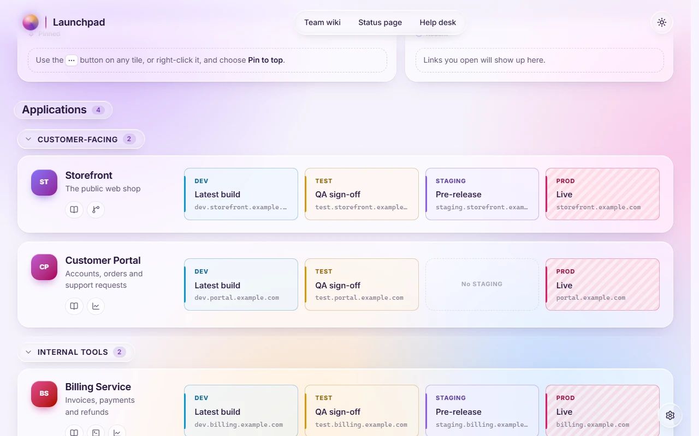
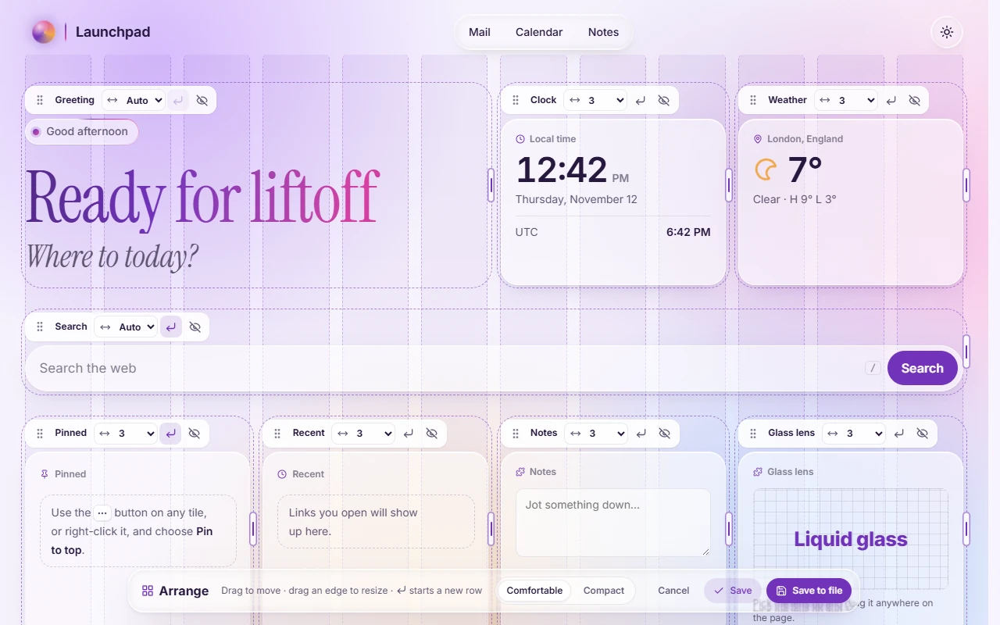

# A tour of the demo

Open the **[demo](https://j-houghton.github.io/launchpad/)** in another tab and follow along. It's the page exactly as it ships, with the sample config: a personal home page with four cards. Nothing you do there affects anyone else; changes stay in your browser.

## 1. The page

From the top:

- **The header** has the page's title and its header links (Mail, Calendar, Notes) in one capsule, and a button that switches between light and dark.
- **The greeting** changes with the time of day. Beside it are the **clock** and the **weather**.
- **The search box** comes from an extension. Press <kbd>/</kbd> anywhere to jump to it.
- **Pinned** and **Recent** start empty. Next to them are a **Notes** scratchpad and a **Glass lens** you can pick up and drag over the page; both are extensions too.
- **The cards** follow: Side projects, Making, Learning and Reading. Each holds **tiles**, the big links. A card with more than four tiles scrolls sideways.

## 2. Tiles

- Click a tile to open it. It then shows up under **Recent**.
- Right-click a tile (or use its **⋯** button) to pin it, copy its address or copy its host.
- Pin two or three, then scroll down until the Pinned panel is out of sight. Your pins come back as a **dock** at the bottom of the window.

While you're down there, notice the **Projects** heading staying under the header, the lens that follows your pointer from tile to tile, and the round buttons in the corner: back to the top, and Settings.

## 3. Settings

Press <kbd>Ctrl</kbd>+<kbd>,</kbd> (<kbd>⌘</kbd>+<kbd>,</kbd> on a Mac) or use the gear in the bottom corner. Settings has two halves, switched at the top:

- **My view** is yours alone: your style, theme, background and colours, which cards you see, your pins.
- **Edit page** changes the page itself: its cards, layout, widgets and title.

In My view, try the other **styles**. Each changes shapes, type and texture as well as colour:

## 4. The other kind of page

The demo opens as a home page. Launchpad's other mode is a **launch page**: each card is an app, with one tile per environment, lined up in columns.

To see one in the demo: Settings → **Edit page** → **File** → **Launch page**, under "Start from an example". Loading an example changes what your browser shows, not the demo itself. **File** → **Use the file's version** takes you back.

## 5. Arranging

Settings → Edit page → **Layout** → **Arrange on the page** puts handles on every section. Drag things around, drag a right edge to resize, then **Save** or **Cancel**.

## Where next

- Making it yours: [Editing and saving](editing.md)
- Running your own copy: the [quick start](../../README.md#quick-start)
- Everything else: the [docs index](../README.md)
