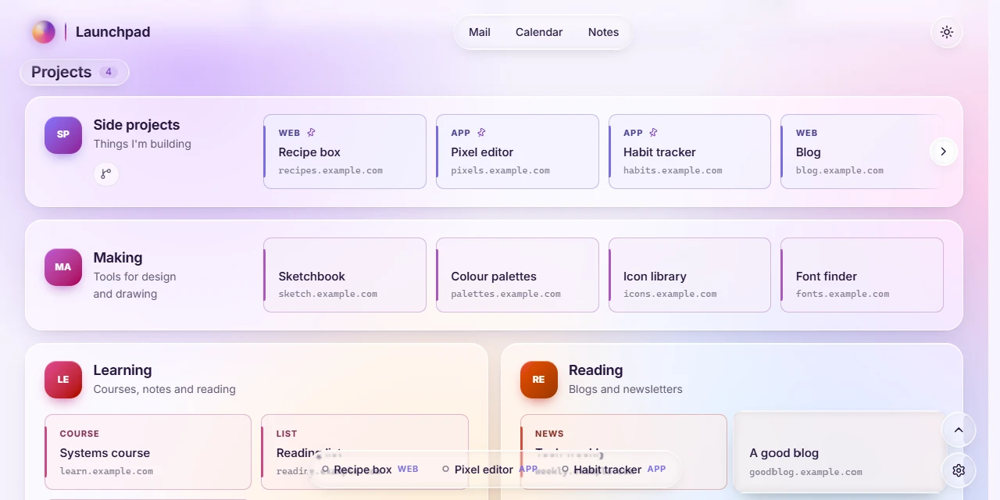

# Liquid glass

How the glass in Aurora, Liquid and Neon is drawn, and what to watch for when adding more. For what it looks like, see [Styles, colours and liquid glass](../functional/looks.md#liquid-glass), or drag the Glass lens about in the [demo](https://j-houghton.github.io/launchpad/).



## The design rule

Launchpad follows Apple's Liquid Glass guidance:

- Glass is for the **layer of controls that floats over the content**: toolbars, buttons, menus, the dock.
- The **content isn't glass**. Cards, widgets and Settings' sheet keep the style's frosted panels.
- Use it sparingly, don't stack glass on glass, and tint only the primary action (the Search button).

Before making something glass, ask whether it's a control or content. `tests/e2e/glass.spec.js` checks that cards and widgets never get a lens.

## How a lens is drawn

The lens comes from the [liquid-glass-filter](https://github.com/J-Houghton/LiquidGLass-UI) package. For each element it builds an **SVG filter** with a displacement map cut to the element's size and corners, and applies it as a `backdrop-filter`, which bends whatever is behind the element.

Only Chromium browsers accept an SVG filter in `backdrop-filter`. Everywhere else the package reports `frost`, and the CSS draws a plain blur.

### `Glass` (`src/lib/glass.ts`)

One `Glass` wraps one element. After each render it hands the CSS what it needs, and `styles/glass.css` does the drawing:

| On the element | What it is |
| --- | --- |
| `data-lens="glass"` or `"frost"` | how it's being drawn |
| `--lens` | the `backdrop-filter` value |
| `--lens-light`, `--lens-lit` | the lens's shading and lit rim, drawn by the element's `::before` |

Things worth knowing:

- **Filters live in one holder** (`.lens-holder`) at the end of `<body>`, so nothing is added inside elements that Lit or an extension renders.
- **The light is its own layer.** Inside the lens's filter, the light would be redone over the backdrop on every frame; on `::before` it's only redrawn when the light moves. This made a page of glass about three times faster. It also means a glass element's `::before` is taken.
- **Lenses start two per frame**, from a queue, and only once their element is connected, so a page with a lot of glass never holds up a paint.
- **Small maps.** The map is the main cost of a lens. Controls use `CONTROL_MAP_PIXELS` (12,000 pixels), stretched to fit; since the map only moves the backdrop about smoothly, it looks much the same.
- **Motion and light attach separately** (`attachGlassMotion`, `attachGlassLight`) and come and go without rebuilding the lens.

### Controls (`src/lib/glass-controls.ts`)

| Export | Use |
| --- | --- |
| `controlGlass(kind)` | a Lit directive for a `'button'`, `'field'`, `'bar'` or `'menu'`. It turns itself on and off with the style |
| `morphMenu`, `morphFrom` | a menu growing out of the button that opens it |
| `glassToast` | a toast |
| `segmentedGlass` | a row of choices whose selection lifts into a draggable lens |
| `glassSwitches`, `sliderGlass` | switch thumbs and slider knobs that become lenses while held |

```ts
html`<button class="icon-btn" ${controlGlass()}>…</button>`
html`<nav class="header-links" ${controlGlass('bar')}>…</nav>`
```

Controls use a 1 px rim (`CONTROL_RIM`), and `themed()` cuts the edge shading to 30% in the light theme, where full shading reads as a grey smudge on a pale page.

The interactive controls follow [kube.io's liquid glass components](https://kube.io/blog/liquid-glass-css-svg).

## Pitfalls

### Glass that turns into a dark slab

A `backdrop-filter` can only see as far as its nearest **backdrop root**. If an ancestor of a glass element creates one, the lens has nothing behind it, and because the lens pins its alpha, it draws as a dark or black slab instead of going transparent.

An ancestor becomes a backdrop root if it has any of:

- `filter` (including one driven by a scroll animation)
- `opacity` below 1
- `mask` or `clip-path`
- `view-transition-name`
- `mix-blend-mode`, or its own `backdrop-filter`

Cases this has caused, and their fixes:

| Symptom | Cause | Fix |
| --- | --- | --- |
| The greeting's pill was a dark blob | `.hero-copy` blurs on scroll with `filter` | the pill sits outside `.hero-copy` |
| The search box and pill went grey while arranging | each `.layout-item` gets a `view-transition-name` so it can glide | `canBeGlass()` holds glass back inside a layout item while arranging; `onArranging()` re-checks when it ends |
| Glass in a masked scroller | the fade mask on the track | the glass sits outside the masked element |

If you add an effect to a container, check what glass lives inside it.

### A hidden lens still bends

Chrome keeps applying a `backdrop-filter` to an element under `visibility: hidden`. Set `backdrop-filter: none` as well. The segmented control's lens does this with a `data-lifted` attribute.

### Glass on a big surface

The lit rim that looks fine on a button is heavy around a card-sized panel. That's a second reason, beyond the design rule, to keep glass on controls.

## Accessibility

`Glass` takes `reducedMotion` and `reducedTransparency`:

- **Less motion** (the device's setting, or My view → Motion → Reduced): no squish or rise, and the light snaps instead of gliding.
- **Less transparency**: frostier glass.
- **More contrast**: a solid edge, in CSS.

## Debugging

- `document.querySelectorAll('[data-lens]')` lists every glass and how it's drawn.
- Switch to a style without glass, such as Classic, to see whether the glass is the cause.
- `tests/e2e/glass.spec.js` runs against the dev server so it can import `glasses` from the source and inspect each lens's handle.
- The package's own guide is in its repository's `docs/`.
